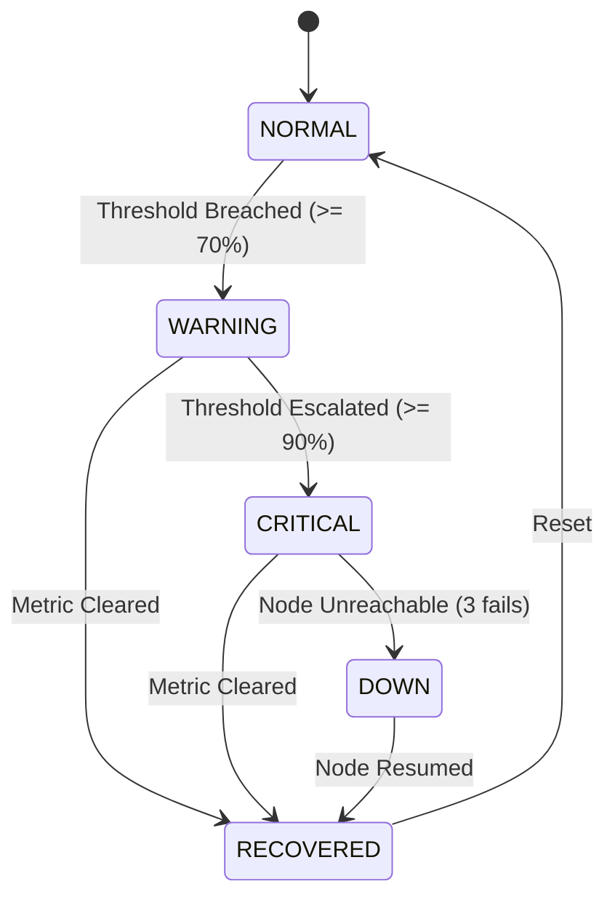

# Incident Alerting & Recovery SRE Runbook

## 1. Alert Lifecycle State Machine

## 2. Notification Dispatch Rules

1. **New Problem**: Dispatches `[WARNING]` or `[CRITICAL]` HTML/plaintext email to NOC list.
2. **Repeated Breaches (Deduplication)**: Internal database record updated with current timestamp and value; **no duplicate email dispatched**.
3. **Escalation**: If severity increases (e.g. `WARNING` $\rightarrow$ `CRITICAL`), an escalation notice is dispatched.
4. **Recovery Notification**: Once the metric clears, a `[RECOVERED]` email is generated with:
   - Problem started time
   - Recovery time
   - Total incident duration (minutes and seconds)
   - Final cleared metric value
5. **Maintenance Suppression**: When an active maintenance window is present, alert records are flagged `SUPPRESSED` and email dispatches are halted.
